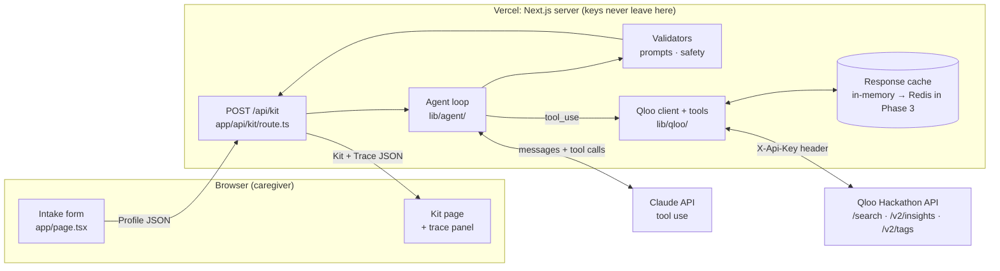
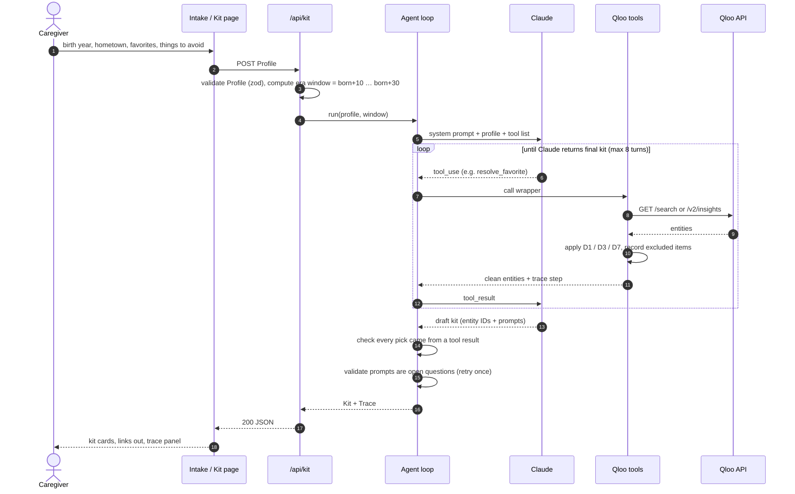
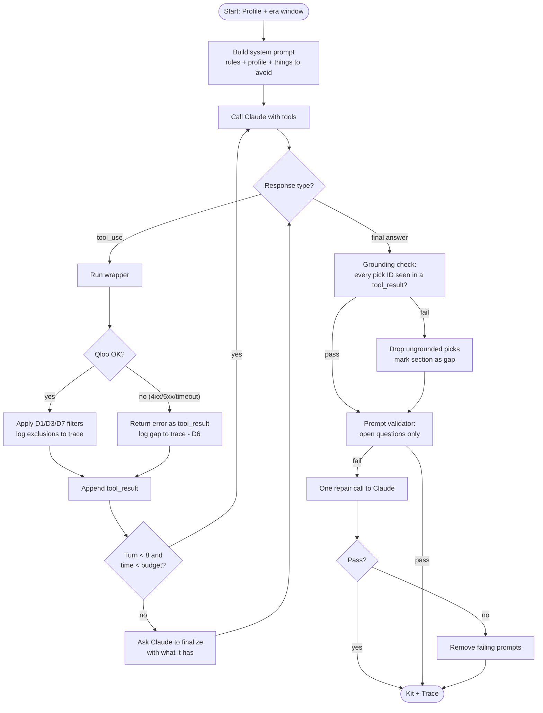
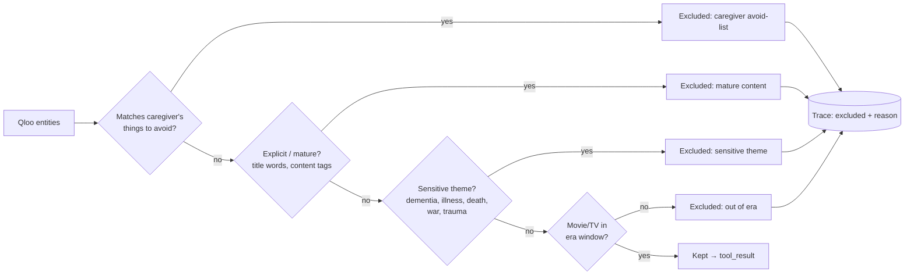
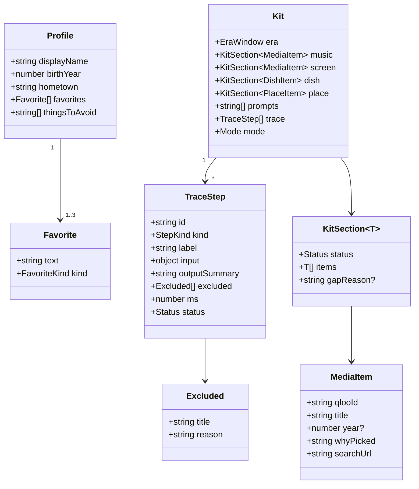
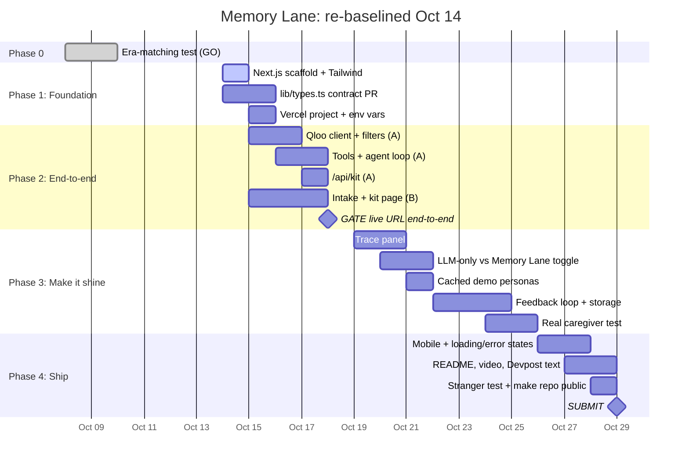
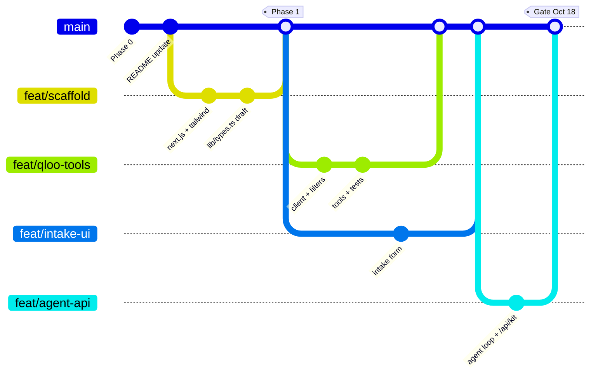
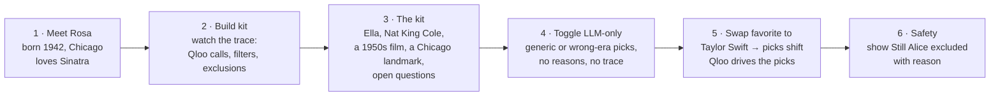

# Memory Lane: Implementation Plan

> **Status:** Draft v1 · 2026-10-14 · Owners: Prathibha (A), Abil (B)
> This plan covers how we build it. *Why* we made each product decision (D1–D7) lives in [approach.md](approach.md). The evidence behind them is in [phase0-results.md](phase0-results.md).
> Diagrams are Mermaid, so GitHub renders them inline and they can be copied into slides.

---

## 1. What we're building (one slide)

**Problem.** Reminiscence activities help caregivers connect with people living with dementia, but building a good session takes hours. You need songs, films, food and places from the person's teenage and young-adult years, from where they grew up, chosen to avoid upsetting topics.

**Memory Lane.** A caregiver enters a birth year, a hometown, 1–3 remembered favorites, and things to avoid. An AI agent uses **Qloo's taste graph** to find era-matched culture and returns a **session kit** with:

| Kit section | Source | Hard rule |
|---|---|---|
| 🎵 Songs / artists (3–5) | Qloo `/v2/insights` seeded by the favorite | Era comes from the seed (D2). No lyrics, link out only |
| 🎬 A film or TV show | Qloo insights + `filter.release_year` | Year window always set in code (D1) |
| 🍲 A dish to talk about | Qloo cuisine/place tags → agent picks a dish | Conversation topic with dietary caveat, not a recipe |
| 📍 A place to reminisce about | Qloo places near the hometown, landmarks preferred | Something to talk about, not a visit suggestion (D4) |
| 💬 Conversation prompts | Claude, grounded in the picks above | Open questions only, checked by a validator |
| 🔍 Agent trace | Every tool call, filter and exclusion | Gaps shown, never filled with invented data (D6) |

Positioning: supports caregivers' activities. **Not therapy, no medical claims.** The MVP serves an individual caregiver. Section 11 covers the path to nursing-care teams.

---

## 2. System architecture



**Why this shape**
- **All API calls happen server-side.** `QLOO_API_KEY` and `ANTHROPIC_API_KEY` exist only in `.env.local` and Vercel env vars. The browser only ever sees the finished kit.
- **Rules live in code, not in the prompt.** Claude decides *what to ask Qloo*. The wrappers in `lib/qloo/` enforce the year filter (D1), the content filter (D3) and dropping the age signal (D7) regardless of what Claude asks for. Prompts can be ignored; code can't.
- **Qloo drives the picks.** Claude can only put an item into the kit if it came back from a Qloo tool call in this request. The kit builder checks this by entity ID.

---

## 3. Request lifecycle

What happens between a caregiver clicking **"Build kit"** and seeing the result:



---

## 4. The agent loop

### 4.1 Tools Claude can call

Each tool is a thin typed wrapper in `lib/qloo/tools.ts`. Claude sees only the name, a description and the input schema. The wrapper adds the rules.

| Tool | Qloo call | What the wrapper enforces |
|---|---|---|
| `resolve_favorite(name, type?)` | `/search` | Returns top 3 candidates with type and year so Claude can disambiguate ("Elvis" the artist vs. the 2022 film) |
| `find_era_artist(era_start, era_end, hint)` | `/search` + `/v2/insights` | D2: used when the favorite is a film or a modern artist. Returns an artist seed from the window |
| `get_music(seed_ids)` | `/v2/insights` `filter.type=artist` | D7: never sends `signal.demographics.age`. D3 content filter |
| `get_screen(seed_ids, kind: movie\|tv)` | `/v2/insights` + `filter.release_year.min/max` | D1: year window injected from the Profile, **not** from Claude's input. D3 filter |
| `get_places(seed_ids, hometown)` | `/v2/insights` `filter.type=place` + `filter.location.query` | D4: rank landmarks / long-standing venues first (tag check, Phase 2 open question) |
| `get_cuisine(hometown, seed_ids)` | `/v2/insights` / `/v2/tags` | Returns cuisine tags. Claude names a dish *from these tags* |

### 4.2 Loop control



**Budget guardrails:** max 8 Claude turns, max ~12 Qloo calls per kit, overall time budget set below the Vercel function limit (`export const maxDuration` in the route). Model chosen through a `CLAUDE_MODEL` env var so we can trade speed against quality without code changes.

---

## 5. Safety and honesty pipeline

Every Qloo result passes through the same gates before Claude or the caregiver sees it. This is where Phase 0's *Still Alice*, *Holocaust* and explicit titles get caught.



| Gate | Where | How |
|---|---|---|
| Content filter (D3) | `lib/qloo/filters.ts` | Keyword list on title + Qloo tags/keywords; unit-tested against the Phase 0 offenders |
| Avoid-list | `lib/qloo/filters.ts` | Case-insensitive match of caregiver's terms against name, tags, genre |
| Grounding | `lib/agent/grounding.ts` | Kit item IDs ⊆ IDs returned by tools in this run |
| Open-question prompts | `lib/agent/validate-prompts.ts` | Must end in `?`; reject assertions about the person's past ("You loved…", "Remember when you…"); one repair attempt |
| No invented data (D6) | Kit builder | A failed section renders as "Couldn't find this: *reason*" |
| Media | Kit page | YouTube/Spotify **search links** built from the title. No embeds, no lyrics |
| Claims | Copy review | No "therapy", "treatment", "improves memory" anywhere in UI or Devpost text |

---

## 6. Shared data contract: `lib/types.ts`

This file is the boundary between A's backend and B's UI. **Both of us must agree to any change** (approach.md). Draft:



> **Key:** `favorites` holds 1–3 items. `thingsToAvoid` is required (the caregiver can enter "none"). `FavoriteKind` = `artist | movie | tv | other`. `Mode` = `memory_lane | llm_only`. `Status` = `ok | gap`. `StepKind` = `llm | tool | filter | validator`.
> `DishItem` = `{ name, cuisineTag, qlooTagId, caveat }`. `PlaceItem` = `{ qlooId, name, kind: "landmark" | "venue", whyPicked }`. Exact TS lands in the Phase 1 PR for review.

---

## 7. Repository layout (target)

```
memory-lane/
├── app/
│   ├── page.tsx                 B  intake form
│   ├── kit/page.tsx             B  kit view + trace panel + mode toggle
│   └── api/kit/route.ts         A  POST /api/kit
├── components/                  B  KitCard, TracePanel, ModeToggle, GapNotice
├── lib/
│   ├── types.ts                 A+B shared contract
│   ├── era.ts                   A  birthYear → { start, end }
│   ├── qloo/
│   │   ├── client.ts            A  fetch, header auth, timeout, retry-once, cache
│   │   ├── tools.ts             A  tool schemas + wrappers (D1, D2, D4, D7)
│   │   └── filters.ts           A  content + avoid-list filters (D3)
│   └── agent/
│       ├── run.ts               A  tool-use loop, budgets
│       ├── prompts.ts           A  system prompt
│       ├── grounding.ts         A  picks ⊆ tool results
│       └── validate-prompts.ts  A  open-question validator
├── fixtures/personas/           A  Rosa, Walt, June: cached kits for the demo
├── tests/                       A+B  vitest: filters, era, validator, grounding
├── scripts/phase0-era-test.mjs     Phase 0 (kept for reproducibility)
└── docs/                           approach, phase0 results, this plan
```

---

## 8. Timeline and phase plan

Phase 1 slipped 4 days (it was due Oct 10). The schedule below is re-baselined from **Oct 14** and keeps the Oct 18 end-to-end gate and the Oct 29 submission.



### Phase 1: Foundation (Oct 14–15)
| # | Task | Owner | Done when |
|---|---|---|---|
| 1.1 | `create-next-app` (App Router, TS, Tailwind, ESLint) on `feat/scaffold` | A | `npm run dev` shows placeholder page |
| 1.2 | `lib/types.ts` from §6 as its own PR | A, reviewed by B | Both approve |
| 1.3 | `lib/era.ts` + vitest set-up with first test | A | `npm test` green |
| 1.4 | Vercel project linked to GitHub, env vars set (Preview + Prod) | A | Every PR gets a preview URL |
| 1.5 | Placeholder intake page using `Profile` type | B | Renders on preview URL |

### Phase 2: End-to-end (Oct 15–18), **gate: live URL by Oct 18**
| # | Task | Owner | Done when |
|---|---|---|---|
| 2.1 | `qloo/client.ts`: header auth, 8s timeout, retry once on 5xx, in-memory cache keyed by URL | A | Unit test with mocked fetch |
| 2.2 | `qloo/filters.ts`: D3 + avoid-list | A | Tests reject *Still Alice*, *Holocaust*, the explicit Phase 0 titles |
| 2.3 | `qloo/tools.ts`: 6 tools from §4.1 | A | Script reproduces Phase 0 era scores through the tools |
| 2.4 | `agent/run.ts` + system prompt + grounding + prompt validator | A | Rosa / Walt / June each produce a full kit locally |
| 2.5 | `POST /api/kit` with zod validation and `maxDuration` | A | `curl` returns Kit JSON on preview URL |
| 2.6 | Intake form → loading state → kit cards, gap notices | B | Works against the live API |
| 2.7 | Answer open questions: landmark tag in `/v2/tags`, dish approach | A | Recorded in approach.md |

### Phase 3: Make it shine (Oct 19–25)
Trace panel (B renders `TraceStep[]`, A makes sure every step is recorded) · LLM-only toggle (same prompt, no tools, clearly labeled) · cached demo personas in `fixtures/` (labeled "cached run from <date>" so they don't count as invented data) · feedback buttons (👍/👎 per item) + storage (Supabase vs Upstash, decide by Oct 19) · one real caregiver walkthrough.

### Phase 4: Ship (Oct 26–29)
Mobile layout, loading and error states · README with screenshots and these diagrams · 2-minute video · Devpost text · a stranger uses it unassisted · **flip repo to public, check MIT shows in About** · submit Oct 29 (hard deadline Oct 30, 10:45 PM CDT).

---

## 9. How we work: Git flow



- `main` is protected. Every change goes through a PR reviewed by the other person, merged within 1–2 days.
- Review on the **Vercel preview URL**, not just the diff.
- `lib/types.ts` changes get their own small PR.

---

## 10. Testing and verification

| Layer | What we check | Tool |
|---|---|---|
| Unit | `era.ts` window, D3 filter on Phase 0 offenders, avoid-list, prompt validator, grounding | vitest |
| Contract | Qloo wrappers against recorded fixtures (Phase 0 raw JSON) | vitest + saved responses |
| Live smoke | Rosa, Walt, June end-to-end against real Qloo + Claude | `scripts/smoke.mjs`, run before each merge to main |
| Era quality | Movies/TV 100% in window (same metric as Phase 0) | smoke script prints era score |
| Failure | Qloo key removed / 500 → kit shows gaps, no invented items | manual + unit test with mocked failure |
| Human | One real caregiver, one stranger | Phase 3 / Phase 4 |

---

## 11. Demo story (for the video and judges)



The comparison (D5) is **modern favorite vs. era favorite**, plus **LLM-only vs. Memory Lane**. A "no favorite" baseline isn't possible because Qloo returns 400 without a signal.

### Scaling path (post-hackathon)
The README frames Memory Lane as scaling **from individual caregivers to nursing care**. The MVP stays single-caregiver and stateless with fictional personas. The architecture leaves room for:
1. **Saved profiles** per resident (needs auth + consented storage. No real resident data until then).
2. **Care-home mode:** staff roles, a resident roster, kits reused across shifts, feedback per resident shaping the next kit.
3. **Group sessions:** overlap of several residents' eras for a shared activity.

---

## 12. Risks and mitigations

| Risk | Likelihood | Impact | Mitigation |
|---|---|---|---|
| Oct 18 gate slips further | Medium | High | Cut scope to music + screen + prompts first; dish and place come second |
| Qloo rate limits / outage during judging | Low–Med | High | Response cache + cached demo personas, clearly labeled |
| Agent too slow (many tool turns) | Medium | Medium | Turn/call caps, parallel tool calls where Claude allows, faster model via `CLAUDE_MODEL` |
| Unsafe title slips through filter | Medium | High | Filter tests from real Phase 0 offenders; caregiver avoid-list; trace makes exclusions visible |
| Places return modern businesses (D4) | High | Medium | Landmark tag filter if `/v2/tags` supports it; otherwise rank by tags and frame as "talk about" |
| Claude asserts facts about the person | Medium | High | Validator + one repair call + remove what still fails |
| Keys leak | Low | High | `.env*` gitignored, server-only modules, no keys in URLs (Qloo key goes in header) |

---

## 13. Open questions (decide by the date shown)

| Question | Decide by | Owner |
|---|---|---|
| Feedback storage: Supabase or Upstash Redis? | Oct 19 | A + B |
| Does `/v2/tags` have a landmark / historic tag for places? | Oct 17 | A |
| Dish: pick from cuisine tags, or from era restaurants' tags? | Oct 17 | A |
| Which Claude model is the default (speed vs. quality)? | Oct 17 | A |
| Stream the trace live (SSE) or show it after? | Oct 19 | B |
