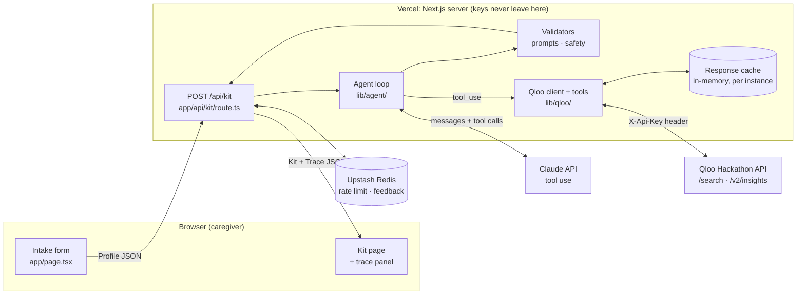
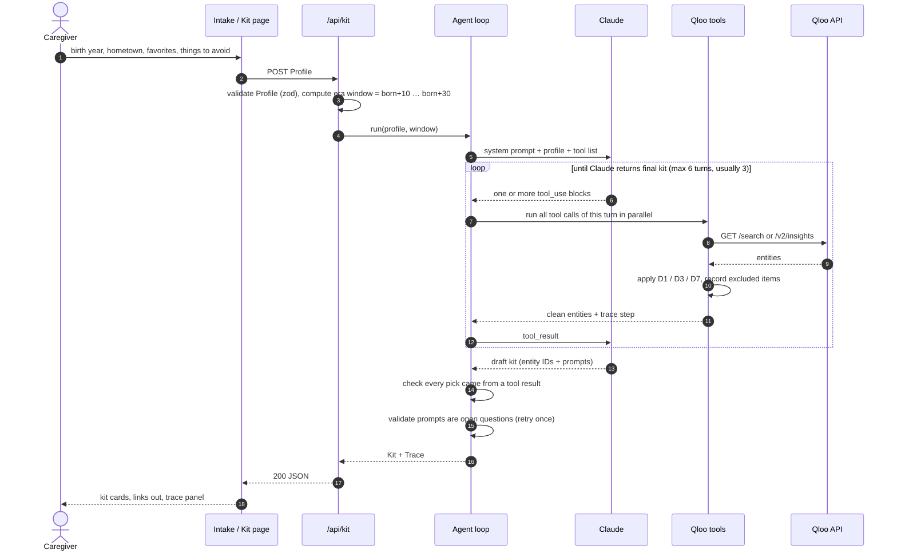
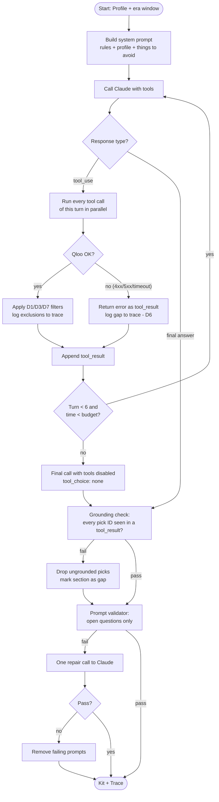
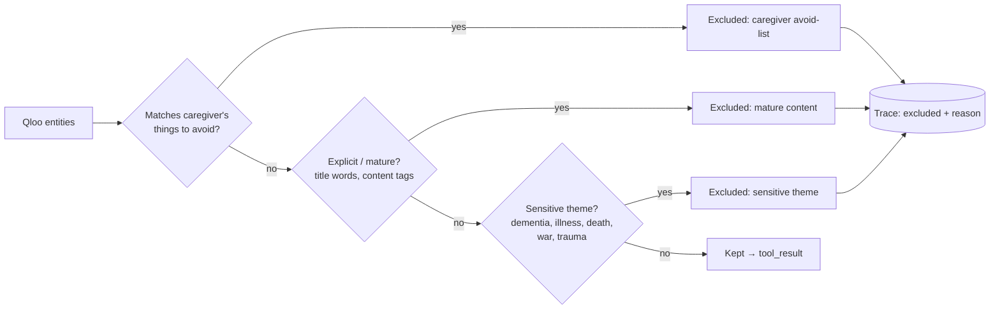
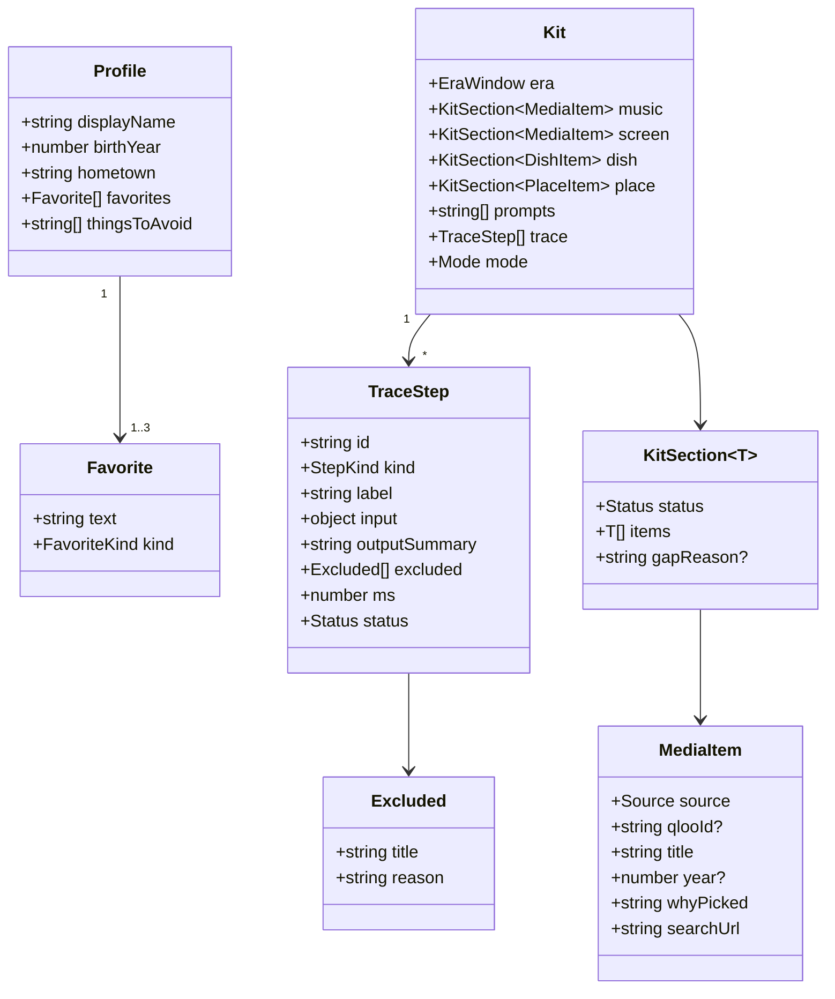
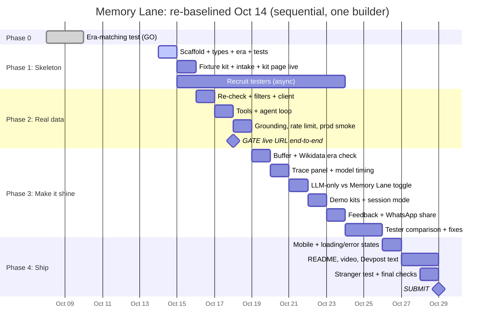
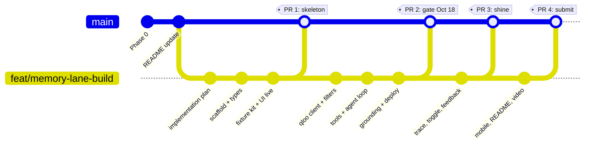
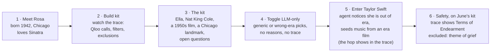

# Memory Lane: Implementation Plan

> **Status:** Draft v1 · 2026-10-14 · updated 2026-10-15 to the [official rules](https://qloo.devpost.com/rules)
> This plan covers how we build it. *Why* we made each product decision (D1–D7) lives in [approach.md](approach.md). The evidence behind them is in [phase0-results.md](phase0-results.md).
> Diagrams are Mermaid, so GitHub renders them inline and they can be copied into slides.

---

## 1. What we're building (one slide)

**Problem.** Reminiscence activities help caregivers connect with people living with dementia, but building a good session takes hours. You need songs, films, food and places from the person's teenage and young-adult years, from where they grew up, chosen to avoid upsetting topics.

**Memory Lane.** A caregiver enters a birth year, a hometown, 1–3 remembered favorites, and things to avoid. An AI agent uses **Qloo's taste graph** to find era-matched culture and returns a **session kit** with:

| Kit section | Source | Hard rule |
|---|---|---|
| 🎵 Songs / artists (3–5) | Qloo `/v2/insights` seeded by the favorite | Era comes from the seed (D2). No lyrics, link out only |
| 🎬 A film or TV show | Qloo insights + `filter.release_year` | Year window always set in code (D1) |
| 🍲 A dish to talk about | Specialty dishes of hometown restaurants in Qloo | Conversation topic with dietary caveat, not a recipe |
| 📍 A place to reminisce about | Qloo places near the hometown, landmarks preferred | Something to talk about, not a visit suggestion (D4) |
| 💬 Conversation prompts | Claude, grounded in the picks above | Open questions only, checked by a validator |
| 🔍 Agent trace | Every tool call, filter and exclusion | Gaps shown, never filled with invented data (D6) |

Positioning: supports caregivers' activities. **Not therapy, no medical claims.** The MVP serves an individual caregiver. Section 11 covers the path to nursing-care teams.

---

## 2. System architecture



**Why this shape**
- **The demo must stay open to judges "without any restriction" until Nov 16** ([official rules](https://qloo.devpost.com/rules)). Saved demo kits are always available with no limit and cost nothing. Live kits get a generous abuse limit that a judge won't hit, so a stranger can't drain the Claude/Qloo budget.
- **All API calls happen server-side.** `QLOO_API_KEY` and `ANTHROPIC_API_KEY` exist only in `.env.local` and Vercel env vars. The browser only ever sees the finished kit.
- **Rules live in code, not in the prompt.** Claude decides *what to ask Qloo*. The wrappers in `lib/qloo/` enforce the year filter (D1), the content filter (D3) and dropping the age signal (D7) regardless of what Claude asks for. Prompts can be ignored; code can't.
- **Qloo drives the picks.** Claude can only put an item into the kit if it came back from a Qloo tool call in this request. The kit builder checks this by entity ID.

---

## 3. Request lifecycle

What happens between a caregiver clicking **"Build kit"** and seeing the result:



---

## 4. The agent loop

### 4.1 Tools Claude can call

Each tool is a thin typed wrapper in `lib/qloo/tools.ts`. Claude sees only the name, a description and the input schema. The wrapper adds the rules.

| Tool | Qloo call | What the wrapper enforces |
|---|---|---|
| `resolve_favorite(name, type?)` | `/search` | Returns top 3 candidates with type and year so Claude can disambiguate ("Elvis" the artist vs. the 2022 film) |
| `get_music(seed_ids)` | `/v2/insights` `filter.type=artist` | D7: never sends `signal.demographics.age`. Avoid-list only (artists carry no rating or themes). Seeds can be any entity type: a film seed works (June: *The Sound of Music* → Carole King, Carpenters, Barbra Streisand) |
| `get_screen(seed_ids, kind: movie\|tv)` | `/v2/insights` + `filter.release_year.min/max` | D1: year window injected from the Profile, **not** from Claude's input. D3 filter |
| `get_places(seed_ids, hometown)` | `/v2/insights` `filter.type=place` + `filter.location.query`, `take=50` | D4: keeps places whose `properties.primary_genre` is on a landmark allowlist, ranked by D4: `historical_landmark` / `heritage_building` first, then `market` / `sculpture` / `park`, then `*museum` (not `water_park`, `amusement_park_ride`). Drops hotels, gyms, chains. The ranking only orders candidates; Claude picks one and says why |
| `get_dish(seed_ids, hometown)` | separate `/v2/insights` place call, `take=50`, restaurants only | Returns `properties.specialty_dishes` (e.g. `chicago_style_pizza` from Giordano's). Both the display names and the slugs are noisy (`giordano_s_house_salad`, `1_2_rack_ribs`), so the wrapper drops entries that start with the restaurant's name or a number, and Claude writes a short name using only words from the slug (checked in grounding, task 2.5). **If no hometown restaurant lists a dish, the section is a gap.** No made-up dish, and no unrelated cuisine standing in for the hometown |

> **Checked against real data (Oct 14), with an honest gap.** In the Phase 0 responses, place entities carry `primary_genre` (Graceland → `museum`, Lorraine Motel → `heritage_building`, Angels Flight → `historical_landmark`) and some restaurants carry `specialty_dishes`. That's enough for **Rosa and Walt**. **June (Los Angeles) is half covered:** 3 of her 10 places pass the allowlist (Angels Flight Railway, an art museum, a railroad museum), but none of her places lists a dish. Phase 0 used `take=10` and the age signal, so task 2.0 re-checks with `take=50`, no age signal, and a restaurants-only call before the tools are written. The same run tests the modern-favorite hop (Taylor Swift → year-filtered films → music seed).

**Modern favorites (D2).** If Claude judges a favorite to be outside the era (e.g. Taylor Swift for someone born in 1942), it doesn't seed music with it. It waits for `get_screen` and seeds `get_music` with the top **in-era film** instead. The window still comes from the Profile, never from Claude, and the hop shows in the trace. This adds one turn (4 instead of 3).

### 4.2 Loop control



**Expected path: 3 Claude turns, not 8.** The slowest part of an agent is waiting on the model one step at a time, so the prompt and tool descriptions steer Claude to batch independent calls in a single turn, and the loop runs them with `Promise.all`:

| Turn | Claude asks for | Qloo calls (in parallel) |
|---|---|---|
| 1 | `resolve_favorite` for each favorite | 1–3 × `/search` |
| 2 | `get_music`, `get_screen(movie)`, `get_screen(tv)`, `get_places`, `get_dish` | 5 × `/v2/insights` |
| 3 | Final kit: picks by ID + open-question prompts | none |

That's **6–8 Qloo calls per kit**, or 7–9 with the modern-favorite hop. The cache dedupes repeats.

**Budget guardrails:** max 6 Claude turns (the last one with tools disabled, so the loop always ends), max 12 Qloo calls per kit, 8 s timeout per Qloo call, overall time budget set below the Vercel function limit (`export const maxDuration` in the route). Model chosen through a `CLAUDE_MODEL` env var so we can trade speed against quality without code changes. Each run logs its total time in the trace, so we can see when it gets slow.

---

## 5. Safety and honesty pipeline

Every Qloo result passes through the same gates before Claude or the caregiver sees it. This is where Phase 0's *Charly*, *Holocaust*, *Terms of Endearment* and explicit titles get caught. The era window isn't a gate here: D1 sends it with the request, so Qloo never returns out-of-era films.



| Gate | Where | How |
|---|---|---|
| Content filter (D3) | `lib/qloo/filters.ts` | Four checks on what Qloo already returns, revised after the Oct 14 re-check ([phase2-recheck.md](phase2-recheck.md)). (1) `content_rating` blocklist (`R`, `NC-17`, `X`, `TV-MA`): *Last Tango in Paris*, *A Clockwork Orange*. (2) Qloo's **War** genre: *Holocaust*, *M\*A\*S\*H*, *The Winds of War*. (3) Sensitive phrases matched against `plot_themes_description` **only**: "dementia", "alzheimer", "cognitive decline", "memory decline", "memory loss", "genocide", "holocaust", "nazi", "totalitarian", "suicide", "drug use", "addiction", "terminal illness", "cancer", "deathbed", "grief", "sexual abuse", "rape". Catches *Still Alice*, *Charly*, *Terms of Endearment*, *Hitler: A Career*, the Rolling Stones documentary. (4) Profanity in the title. **Not** keyword tags: they record minor plot details and would have dropped *The Sound of Music* ("Nazi" tag), *The Princess Bride* and 19 of June's 25 TV shows. Result on all saved responses: 43 of 193 titles excluded (22%), all 8 known offenders caught, every classic tested kept |
| Over-filtering | `lib/qloo/tools.ts` | Ask Qloo for `take=25`, filter, keep the top 5. If fewer than 3 survive, the section says so (gap) instead of padding |
| Avoid-list | `lib/qloo/filters.ts` | Case-insensitive match of caregiver's terms against name, tags, genre |
| Grounding | `lib/agent/grounding.ts` | Every kit item's entity ID (or, for the dish, its specialty-dish tag ID) was returned by a tool in this run. Applies to Memory Lane mode only |
| LLM-only mode | `lib/agent/llm-only.ts` | Separate path with no tools and no grounding. Items carry `source: "llm"` and no Qloo ID, and the UI labels them "not checked against Qloo". The D3 filter can't run (no Qloo metadata), which is part of what the comparison shows |
| Open-question prompts | `lib/agent/validate-prompts.ts` | Each prompt is one question ending in `?`. Rejects statements and presumptions about the person's past ("You loved…", "You used to…", imperative "Remember when you…"). Allows invitations ("Do you remember…?", "What was…?"). At least 3 of 5 must be open (What / How / Who / Where / Tell me). One repair attempt |
| No invented data (D6) | Kit builder | A failed section renders as "Couldn't find this: *reason*" |
| Media | Kit page | YouTube/Spotify **search links** built from the title. No embeds, no lyrics |
| Claims | Copy review | No "therapy", "treatment", "improves memory" anywhere in UI or Devpost text |

---

## 6. Shared data contract: `lib/types.ts`

This file is the contract between the server (`/api/kit`, agent, Qloo tools) and the UI. Changes to it go in their own small PR so they're easy to review. Draft:



> **Key:** `favorites` holds 1–3 items. `thingsToAvoid` is required (the caregiver can enter "none"). `FavoriteKind` = `artist | movie | tv | other`. `Mode` = `memory_lane | llm_only`. `Status` = `ok | gap`. `StepKind` = `llm | tool | filter | validator`. `Source` = `qloo | llm`: `qlooId` is required when `source` is `qloo`, and absent in LLM-only mode.
> `DishItem` = `{ source, name, qlooTagId?, fromPlace?, caveat }`. `PlaceItem` = `{ source, qlooId?, name, genre?, whyPicked }`. Same rule as `MediaItem`: Qloo IDs are required when `source` is `qloo`. Exact TS lands in the Phase 1 PR for review.

---

## 7. Repository layout (target)

```
memory-lane/
├── app/
│   ├── page.tsx                   one page: intake form → kit (profile never in the URL)
│   └── api/kit/route.ts           POST /api/kit
├── components/                    MemoryLaneApp, IntakeForm, KitView (+ TracePanel, ModeToggle later)
├── lib/
│   ├── types.ts                   shared server ↔ UI contract
│   ├── era.ts                     birthYear → { start, end }
│   ├── ratelimit.ts               per-IP limit + daily cap (Upstash Redis)
│   ├── qloo/
│   │   ├── client.ts              fetch, header auth, timeout, retry-once, cache
│   │   ├── tools.ts               tool schemas + wrappers (D1, D2, D4, D7)
│   │   └── filters.ts             content + avoid-list filters (D3)
│   └── agent/
│       ├── run.ts                 tool-use loop, budgets
│       ├── llm-only.ts            comparison mode: no tools, no grounding
│       ├── prompts.ts             system prompt
│       ├── grounding.ts           picks ⊆ tool results
│       └── validate-prompts.ts    open-question validator
├── fixtures/
│   ├── kits/                      Rosa, Walt, June: cached kits for the demo
│   └── qloo/                      recorded Qloo responses for tests
├── tests/                         vitest: filters, era, validator, grounding
├── scripts/
│   ├── phase0-era-test.mjs        Phase 0 (kept for reproducibility)
│   ├── qloo-recheck.mjs           task 2.0, writes fixtures/qloo/
│   └── smoke.mjs                  3 personas against the live URL
└── docs/                         approach, phase0 results, this plan
```

---

## 8. Timeline and phase plan

Phase 1 slipped 4 days (it was due Oct 10). The schedule below is re-baselined from **Oct 14**, keeps the Oct 18 end-to-end gate and the Oct 29 submission, and is **sequential**: it assumes one builder, so no two build tasks overlap.

**Strategy: walking skeleton first.** By the end of Oct 15 a deployed URL takes a Profile and shows a kit, but the kit comes from a saved fixture. Every later day replaces one fake piece with the real one. The scary integration work (Vercel, env vars, the server ↔ UI contract) is then done on day 2 instead of the night of Oct 18, and the gate can't be missed because of deployment problems.



### Phase 1: Skeleton (Oct 14–15) · PR 1
| # | Task | Done when |
|---|---|---|
| 1.1 | `create-next-app` (App Router, TS, Tailwind, ESLint) | `npm run dev` shows placeholder page |
| 1.2 | `lib/types.ts` from §6, `lib/era.ts`, vitest with first tests | `npm test` green |
| 1.3 | `fixtures/kits/rosa.json`: a hand-checked Kit built **only** from Rosa's Phase 0 Qloo results | Validates against `lib/types.ts` |
| 1.4 | `POST /api/kit`: zod-validates the Profile, sets `maxDuration`, returns the fixture (`KIT_SOURCE=fixture`) | `curl` returns Kit JSON; bad input gets a 400 |
| 1.5 | Basic intake form → kit page rendering every section + gap state | Works locally end to end |
| 1.6 | Vercel project linked. Env vars for Preview + Production: `QLOO_API_KEY`, `ANTHROPIC_API_KEY`, `CLAUDE_MODEL` (a fast default, revisited Oct 20), `SMOKE_TOKEN`, Upstash Redis via the Vercel integration | Production URL shows 1.5 |
| 1.7 | Find 2–3 testers: adults aged 60+ (era accuracy) and people who have looked after an older relative ([business-case.md §6](business-case.md#6-evidence-plan-no-caregiver-available)) | Testers and dates booked for Oct 24–25 |

### Phase 2: Real data (Oct 16–18) · PR 2 · **gate: live production URL by Oct 18**
| # | Task | Day | Done when |
|---|---|---|---|
| 2.0 | `scripts/qloo-recheck.mjs`: the 3 personas with no age signal, `take=25/50`, separate places and restaurants calls, plus the Taylor Swift hop. Saves the responses to `fixtures/qloo/`, and also copies the Phase 0 responses that contain the offenders (unfiltered movies, year-filtered lists) so filter tests don't depend on what Qloo returns today | Oct 16 AM | June has ≥ 1 allowlisted place; her dish is found or the gap is accepted and written down; the hop returns in-era films; we know whether *Charly* still appears for Rosa without the age signal (if not, demo step 6 uses whichever title the trace excludes) |
| 2.1 | `qloo/filters.ts`: D3 + avoid-list (§5), tested against `fixtures/qloo/` and `fixtures/qloo/phase0/` | Oct 16 | Rejects *Still Alice*, *Holocaust*, *Last Tango in Paris*, *Charly*, *Terms of Endearment*, *Hitler: A Career*, *A Clockwork Orange* and the explicit documentary; keeps *The Sound of Music*, *The Princess Bride*, *Mary Poppins*, *Kramer vs. Kramer* |
| 2.2 | `qloo/client.ts`: header auth, 8 s timeout, retry once on 5xx, in-memory cache keyed by URL (small: the Phase 0 script already has the fetch logic) | Oct 16 PM | Unit test with mocked fetch |
| 2.3 | `qloo/tools.ts`: tools from §4.1 | Oct 17 | Era score through the tools matches Phase 0 (100% movies/TV) |
| 2.4 | `agent/run.ts` + system prompt; the loop pushes a `TraceStep` for every call (a plain array, no UI yet) | Oct 17 | Rosa / Walt / June each produce a kit locally in ≤ 4 Claude turns |
| 2.5 | Grounding check (IDs + dish-name words ⊆ slug words) + `lib/ratelimit.ts` (`@upstash/ratelimit`, a few lines; a generous per-IP abuse limit on **live** kits only; requests carrying the server-side `SMOKE_TOKEN` header are exempt), `KIT_SOURCE=agent` | Oct 18 AM | Ungrounded test pick is dropped; a burst well beyond normal use gets a 429, normal use and smoke requests don't; demo kits are never limited |
| 2.6 | Production deploy + `scripts/smoke.mjs` | Oct 18 PM | All 3 personas pass smoke on the **production** URL (preview URLs can sit behind Vercel's deployment protection) |

**If Oct 17 runs late:** ship the gate with music + film/TV + prompts, and add places and dish on Oct 19 (two small tools on the same client). The prompt validator is on Oct 19 and model timing on Oct 20; until then the system prompt carries the open-question rule alone. Oct 18 afternoon is deploy and smoke only, because the route, zod and env vars have been live since Oct 15.

### Phase 3: Make it shine (Oct 19–25) · PR 3
Priorities follow the official judging criteria ([business-case.md §4](business-case.md#4-how-the-hackathon-judges-it)).
- **Oct 19:** buffer for anything left from the gate. **Wikidata era check:** opening and release dates confirm a place, venue or title existed in the person's era (public domain, no key), so the check doesn't rely on the model's memory. The prompt validator is already done.
- **Oct 20:** **trace panel** (renders `TraceStep[]`; shows Qloo's work and what was screened out) + timing the personas on two models to confirm `CLAUDE_MODEL`.
- **Oct 21:** **LLM-only toggle** (`llm-only.ts`, same prompt, no tools, clearly labeled).
- **Oct 22:** **demo kits** in `fixtures/kits/` for each persona (labeled "saved run from <date>", never rate-limited) + **session mode** (large type, one item at a time, "next").
- **Oct 23:** **feedback buttons** (👍/👎 per item, stored in Upstash; first to cut if behind) + **"Send to WhatsApp"** share link with a text version of the kit (no API).
- **Oct 24–25:** **tester comparison** (blind AI-only vs Memory Lane with adults aged 60+) and fixes. Results reported exactly as they happened.

### Phase 4: Ship (Oct 26–29) · PR 4
Mobile layout, loading and error states · README with screenshots and these diagrams · Devpost text (features, the reminiscence reasoning, tester results) · 2-minute video (not required by the rules, but judges may score from the description and video alone) · a stranger uses it unassisted · check the repo About shows MIT and the live URL · submit Oct 29 (hard deadline Oct 30, 11:45 PM ET).

**After submission (Oct 30 – Nov 16):** the demo must keep working, free and unrestricted, until judging ends. Keep the Qloo key valid, Claude credits funded and Vercel up; check the live URL every few days.

---

## 9. How we work: Git flow



- Work happens on `feat/memory-lane-build` and lands on `main` through one PR per phase, so each review stays small.
- Review is welcome but never blocks the schedule: a PR stays open up to 24 h for comments, then merges. If a review is still open on Oct 18, the branch is promoted to production in Vercel, so the gate doesn't wait on a merge.
- Review on the **Vercel preview URL**, not just the diff.
- Changes to `lib/types.ts` after Phase 1 get their own small PR.

---

## 10. Testing and verification

| Layer | What we check | Tool |
|---|---|---|
| Unit | `era.ts` window, D3 filter on Phase 0 offenders, avoid-list, prompt validator, grounding | vitest |
| Contract | Qloo wrappers against recorded responses in `fixtures/qloo/` (written by task 2.0, plus the Phase 0 offender responses) | vitest, no network, no API quota used |
| Live smoke | Rosa, Walt, June end-to-end against real Qloo + Claude | `scripts/smoke.mjs`, run before each merge to main (≈ 20–25 Qloo calls per run, so not on every commit) |
| Era quality | Movies/TV 100% in window (same metric as Phase 0) | smoke script prints era score |
| Failure | Qloo key removed / 500 → kit shows gaps, no invented items | manual + unit test with mocked failure |
| Human | One real caregiver, one stranger | Phase 3 / Phase 4 |

---

## 11. Demo story (for the video and judges)



The comparison (D5) is **modern favorite vs. era favorite** (step 5 shows the agent routing around a modern favorite) plus **LLM-only vs. Memory Lane** (step 4). A "no favorite" baseline isn't possible because Qloo returns 400 without a signal.

### Scaling path (post-hackathon)
The README frames Memory Lane as scaling **from individual caregivers to nursing care**. The MVP stays single-caregiver and stateless with fictional personas. The architecture leaves room for:
1. **Saved profiles** per resident (needs auth + consented storage. No real resident data until then).
2. **Care-home mode:** staff roles, a resident roster, kits reused across shifts, feedback per resident shaping the next kit.
3. **Group sessions:** overlap of several residents' eras for a shared activity.

---

## 12. Risks and mitigations

| Risk | Likelihood | Impact | Mitigation |
|---|---|---|---|
| Oct 18 gate slips further | Medium | High | Cut scope to music + screen + prompts first; dish and place come second |
| Qloo rate limits / outage during judging | Low–Med | High | Response cache + cached demo personas, clearly labeled |
| Agent too slow (many tool turns) | Medium | Medium | Parallel tool calls in one turn (3-turn path, §4.2), turn/call caps, faster model via `CLAUDE_MODEL`, run time logged in every trace |
| Unsafe title slips through filter | Medium | High | Filter tests from real Phase 0 offenders; caregiver avoid-list; trace makes exclusions visible |
| Places return modern businesses (D4) | High | Medium | `primary_genre` allowlist (verified in Phase 0 data); frame as "a place to talk about"; show a gap if nothing passes |
| Filters remove too much, sections come back empty | Medium | Medium | `take=25` then filter to 5; phrase-based theme matching, not single words; tests include a title that must be kept |
| Reviews arrive slowly | High | Medium | Review never blocks: 24 h comment window, then merge or promote the branch to production |
| Public endpoint drains API quota | Medium | High | Generous abuse limit on live kits (task 2.5); unlimited saved demo kits for judges |
| Demo stops working during judging (credits run out, key expires) | Medium | High | Budget Claude credits through Nov 16 from the measured cost per kit; demo kits need no API at all; check the live URL every few days |
| A rate limit blocks a judge (rules require access "without any restriction") | Low | High | Demo kits are never limited; the live-kit limit only stops bursts far above normal use |
| June-style cities have no landmark or dish in Qloo results | Medium | Medium | Task 2.0 re-check on Oct 16; restaurants-only call; honest gap otherwise |
| No caregiver available for the test | Confirmed | Medium | Test era accuracy with adults aged 60+ and usefulness with people who have looked after a relative; report exactly who tested ([business-case.md §6](business-case.md#6-evidence-plan-no-caregiver-available)) |
| Claude asserts facts about the person | Medium | High | Validator + one repair call + remove what still fails |
| Keys leak | Low | High | `.env*` gitignored, server-only modules, no keys in URLs (Qloo key goes in header) |

---

## 13. Open questions (decide by the date shown)

| Question | Decide by | Status |
|---|---|---|
| Places: how do we find landmarks? | — | **Answered Oct 14:** `primary_genre` allowlist with `take=50` finds landmarks for all three cities (7 for June). Claude still applies era judgment: the allowlist lets in modern attractions |
| Dish: where does it come from? | — | **Answered Oct 14:** a separate restaurants call, keeping only places that list `specialty_dishes`. Finds dishes for all three cities |
| Which Claude model is the default (speed vs. quality)? | Oct 20 | A fast default ships Oct 15; timing on two models confirms it |
| Stream the trace live (SSE) or show it after? | Oct 19 | Show after, unless runs take > 15 s |
| Feedback storage: Supabase or Upstash Redis? | — | **Decided:** Upstash Redis, already needed for the rate limit |

---

## 14. Bottleneck review (Oct 14)

Before building, each step was checked for anything that could stall it. What was found and what changed:

| # | Bottleneck | Evidence | Fix in this plan |
|---|---|---|---|
| 1 | Timeline had 3 build tasks running at once on Oct 15–18 | One builder | Sequential schedule (§8) |
| 2 | First deploy was planned for Oct 18, the gate day | Vercel + env + contract problems would surface at the last minute | Walking skeleton live on Oct 15 (tasks 1.3–1.6) |
| 3 | Agent could take up to 8 model round-trips | Each turn waits on Claude | Parallel tool calls, 3-turn path, cap 6 (§4.2) |
| 4 | Places and dish depended on an untested `/v2/tags` idea, scheduled after the tools were built | Open question with no date before the tools | Use `primary_genre` / `specialty_dishes` from Phase 0 data; June gap gets re-checked first thing (task 2.0) |
| 5 | Title keyword filter would miss *Still Alice*, *Charly*, *Terms of Endearment* and wrongly drop *Kramer vs. Kramer* ("Hospital" tag) | Phase 0 raw responses | Rating + theme phrases over themes, keywords and tags (§5), tested on all of them |
| 6 | Contract tests pointed at `scripts/out/`, which is gitignored | `.gitignore` | Task 2.0 writes responses to `fixtures/qloo/` and copies the Phase 0 offenders |
| 7 | Docs said `main` is protected and every PR needs an approving review | GitHub API: branch not protected | Review is non-blocking with a 24 h window (§9) |
| 8 | Caregiver test booked for Oct 24 with no recruiting step | Needs lead time | Ask on Oct 15 (task 1.7) |
| 9 | "Flip repo to public" task in Phase 4 | Repo is already public | Removed. Anything pushed is visible immediately, and the no-secrets rule matters from now on |
| 10 | Oct 17 held tools, loop, grounding, validator and model timing | Independent review | Grounding → Oct 18, validator → Oct 19, model timing → Oct 20 (§8) |
| 11 | Finalize step could loop forever | Loop diagram had no exit | Last call runs with tools disabled (§4.2) |
| 12 | `find_era_artist` had no Qloo mechanism and took the era window from Claude | No artist year filter exists | Removed; modern favorites hop through an in-era film (§4.1) |
| 13 | LLM-only mode couldn't satisfy grounding or the types | `qlooId` was required | Separate path, `source` field, optional ID (§5, §6) |
| 14 | Public `/api/kit` with no limit; preview URLs may be protected | Vercel defaults | Upstash rate limit + daily cap, gate on production URL (tasks 2.5–2.6) |
| 15 | Oct 16, 17, 18, 19 each overloaded at some point | Second and third review | Re-check script writes the test fixtures; client on Oct 16 (reuses Phase 0 fetch code) so Oct 17 is tools + loop only; route, zod and env vars moved to Oct 15; Oct 19 split into Oct 19–21 (§8) |
| 17 | Smoke runs would trip the rate limit | Third review | `SMOKE_TOKEN` exemption (task 2.5) |
| 18 | The D3 filter as designed would have emptied kits: keyword-tag matching dropped *The Sound of Music*, *The Princess Bride*, 19/25 of June's TV | Task 2.0 re-check against live Qloo | Phrases on the theme summary only, plus Qloo's War genre (§5, D3) |
| 19 | *Charly* no longer comes back for Rosa without the age signal, so demo step 6 had no example | Task 2.0 | Demo step 6 uses June's *Terms of Endearment* (§11) |
| 16 | Dish fallback named an unrelated cuisine ("a French dish" for Los Angeles); demo step 6 relied on *Still Alice*, which D1 already removes | Second review | Dish gap instead of a fallback; demo uses *Charly* (1968), which is in Rosa's window |

**What's still a risk, stated plainly:** the schedule has no slack before Oct 18 other than the stated fallback. Task 2.0 (run Oct 14) verified June's place and dish and the Taylor Swift hop. "Zero bottlenecks" isn't a promise anyone can make for a 15-day build; the goal of this review is that every known one has a fix or a fallback with a date.
