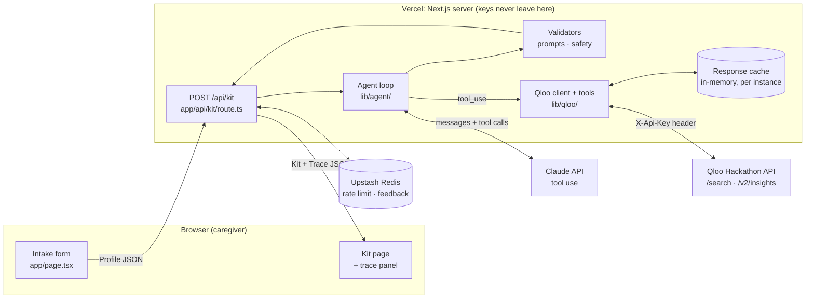
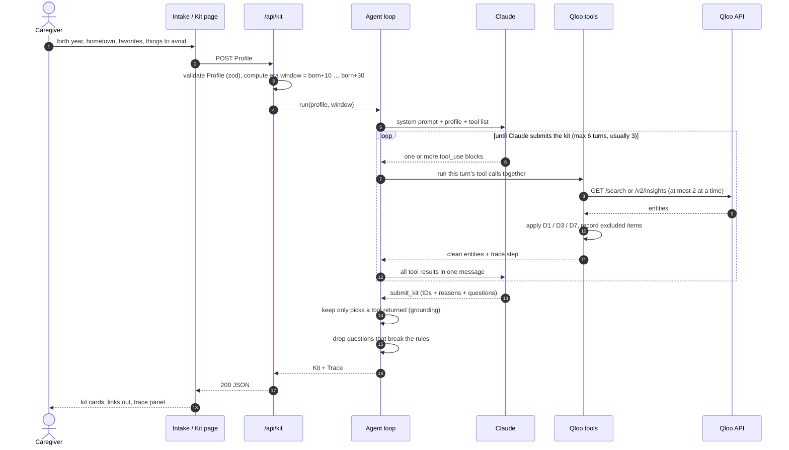
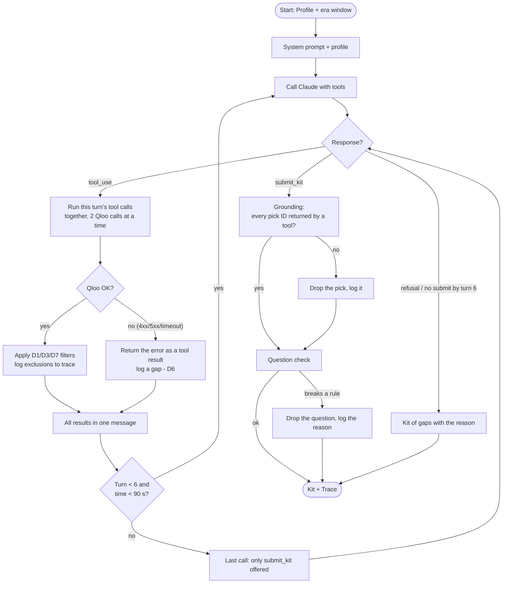
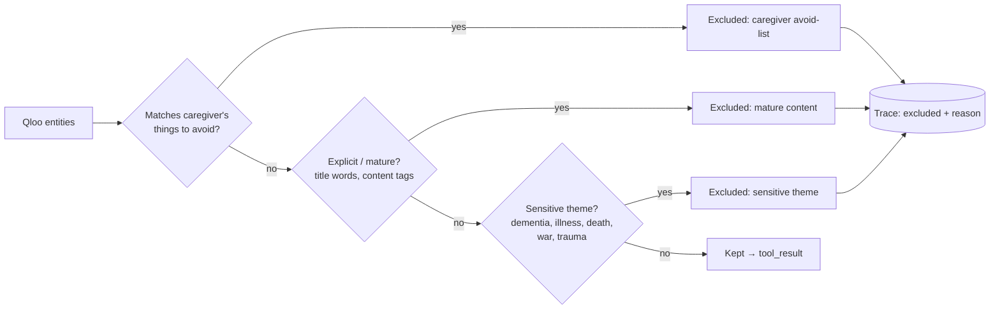
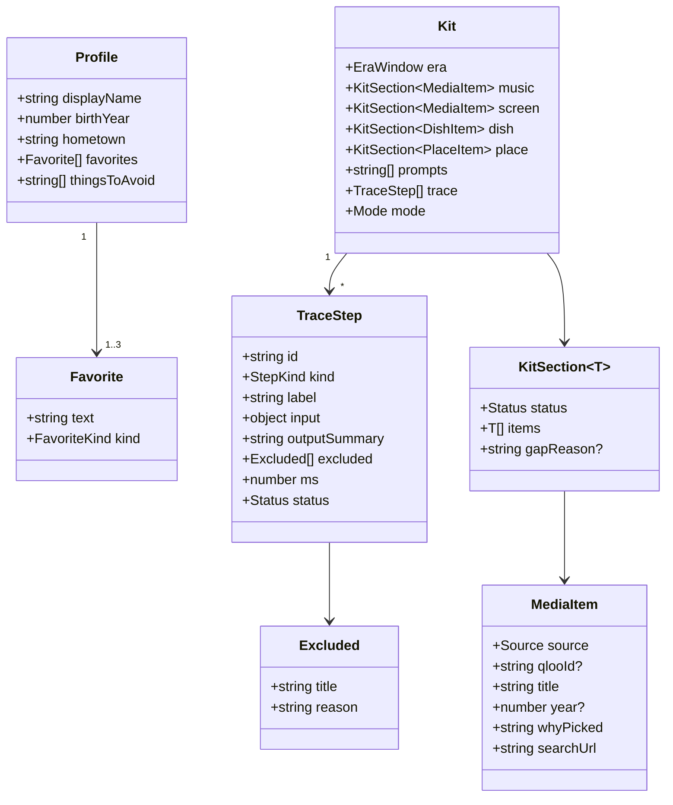
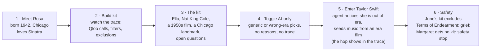
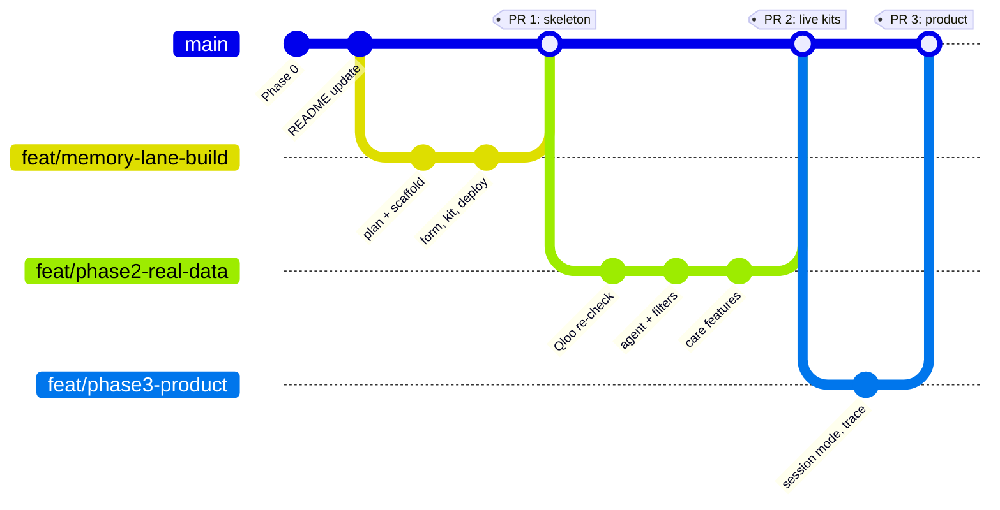

# Memory Lane: Plan

> **Living document** · last updated 2026-10-15 · deadline Oct 30, 2026, 11:45 pm ET ([official rules](https://qloo.devpost.com/rules))
> One place for what we're building, why, the decisions, the design and the schedule. The Qloo test evidence behind the decisions is in [research.md](research.md).
> Diagrams are Mermaid: GitHub renders them inline, and they can be copied into slides.

**Contents:** 1 What we're building · 2 Who it's for and how it's judged · 3 Decisions · 4 Rules and care principles · 5 Architecture · 6 Request lifecycle · 7 The agent · 8 Safety pipeline · 9 Data contract · 10 Code layout · 11 Status and schedule · 12 Planned changes · 13 Testing · 14 Demo story · 15 Roadmap and resources · 16 Risks · 17 Open questions · 18 How we work · 19 Lessons from reviews

---

## 1. What we're building

**Problem.** Reminiscence activities (music, films, food and places from someone's youth, plus gentle conversation) are a recognized non-drug approach in dementia care. Putting together a *personal* session is hard: it takes time, and knowledge of another person's era, hometown and tastes. Generic playlists miss the person; the wrong item can upset them.

**Memory Lane.** A caregiver enters a few details (birth year, hometown, 1–3 remembered favorites, things to avoid). An agent uses **Qloo's taste graph** to find what people with those favorites also loved, limited to the person's formative years, and returns a **session kit**:

| Kit section | Source | Rule |
|---|---|---|
| 🎵 Songs / artists (3–5) | Qloo insights seeded by the favorite | Era comes from the seed (D2). Link out only, no lyrics |
| 🎬 A film or TV show | Qloo insights with a release-year window | Window set in code from the birth year (D1) |
| 🍲 A dish to talk about | Specialty dishes of hometown restaurants in Qloo | Conversation only, with a food-safety note (P9) |
| 📍 A place to talk about | Qloo places in the hometown, landmarks first | Not a visit suggestion (D4) |
| 💬 Conversation questions | Claude, tied to the picks | Gentle open questions, checked in code (P1, P2) |
| 🔍 Trace | Every Qloo call, filter and exclusion | Gaps shown, never filled with guesses (D6) |

Memory Lane supports caregivers' activities. **It is not therapy and makes no medical claims.**

---

## 2. Who it's for and how it's judged

### 2.1 Audience

| Audience | Need | Strength as a business |
|---|---|---|
| Family caregivers | Ideas for meaningful time together | Highest emotional need, lowest willingness to pay, occasional use |
| **Activity coordinators** in care homes, memory care and adult day programs | Fresh, personal activities every day, for many residents | Daily use, many people per account, existing budgets: **the strongest path** |
| Care organizations and senior-living software | Activity content inside tools staff already use | Partnership or licensing later |

### 2.2 Honest assessment

| Lens | Rating | Why |
|---|---|---|
| Problem | Strong | Real, frequent, emotional |
| Who pays | Mixed | Families feel it most; care settings can pay |
| Differentiation | **Must be proven** | A general chatbot can list "songs from 1950s Chicago". Our edge is personal picks from one favorite, safety screening, nothing invented, and a complete session tool. The tester comparison (§12.8) has to show it |
| Lasting advantage | Weak today, strong later | Learning per person from session feedback |
| Risks | Manageable | Vulnerable users (privacy, upsetting content, medical claims) are covered by §4. Business risks: Qloo access and pricing after the hackathon, AI cost per kit |

### 2.3 Judging (official rules)

Stage one is pass/fail: the project fits the theme and reasonably applies the Qloo API. Stage two scores four **equally weighted** criteria; ties are broken by the first.

| Criterion | What judges look for | What earns it |
|---|---|---|
| **Technological implementation** (tie-breaker) | How thoroughly and skillfully Qloo is used; non-trivial working code | Search + insights with year, location and tag filters, entity seeding, the film-to-music hop, safety screening and grounding to Qloo IDs; trace panel makes it visible |
| **Design** | A complete, coherent product, not a proof of concept | Session mode, session note, safety stop, demo kits that always work |
| **Potential impact** | A credible case for a real audience, *based on what's demonstrated* | Care-practice design (§4.2) and the tester comparison |
| **Quality of the idea** | A creative use of Qloo and real understanding of the problem | Era fidelity from one favorite; care principles built into the product |

**Rules that shape the build:** the project must be **agentic** and **integrate Qloo**; **other APIs and data are allowed** if we're authorized under their terms; the demo must stay **free and unrestricted until judging ends on Nov 16**; required are a working demo link, a public repo with an **open-source license visible in About**, and a text description. A video isn't required, but judges may score from the description and video alone, so we make one. Judges may use AI-assisted analysis, so the README and description must be clear.

---

## 3. Decisions

| # | Decision | Why |
|---|---|---|
| D1 | Every film/TV call sets `filter.release_year.min/max` from the birth year (ages 10–30), in code, never from Claude | Without it, 0% of films were in era for 2 of 3 personas ([research §1](research.md#1-phase-0-can-qloo-match-an-era-oct-8)) |
| D2 | Music's era comes from its seed. Any entity can seed music (a film works). If a favorite is modern, seed music with the top in-era film instead | `filter.release_year` doesn't apply to artists. Verified: Taylor Swift → *Mary Poppins* (1964) → Sinatra, Dean Martin, Carole King |
| D3 | Content filter on every result: rating blocklist (R, NC-17, X, TV-MA); Qloo's **War** genre; sensitive phrases in `plot_themes_description` **only**; profanity in the title. Exclusions shown in the trace with a reason | Keyword tags record minor plot details: matching them dropped *The Sound of Music* and 19 of June's 25 TV shows. Theme-only catches all 8 known offenders and keeps every classic tested ([research §2.3](research.md#23-the-content-filter)) |
| D4 | Places: landmark genres first, framed as "a place to talk about". Claude then picks one (and a restaurant for the dish) that existed in the person's era and says why | The genre allowlist also lets in modern attractions (Cloud Gate, 2006) and themed restaurants |
| D5 | Demo comparison: modern vs. era favorite, plus AI-only vs. Memory Lane | Qloo rejects requests with no favorite (400) |
| D6 | A failed Qloo call or an empty section shows the gap and the reason. Never filled with invented data | Project rule |
| D7 | Never send `signal.demographics.age` | The age signal reflects what an age group likes *today*, not when they were young |
| D8 *(built Oct 15; wording under team review)* | Stage-aware kits: the caregiver chooses the support level; it changes the mix and the questions | Care practice: support needs change with the stage, and day to day |
| D9 *(built Oct 15; wording under team review)* | Sudden-change check before any kit; "yes" returns a safety stop and makes no API calls | Care practice: a sudden change is reported for medical evaluation, never assumed to be progression |
| D10 *(built Oct 15)* | Stricter question rules: no "Do you remember…", no quizzes, one idea per card, adult tone | Care practice: avoid testing memory. Replaced the earlier checker, which allowed "Do you remember…?" |
| D11 *(proposed)* | Session notes are built and kept in the caregiver's browser; nothing about a real person is stored by Memory Lane | Privacy: observations about a real person's care are health-related information |
| D12 *(proposed)* | Model-written suggestions (activity ideas) are labeled as suggestions, never presented as Qloo data | Honesty: only Qloo-grounded items carry Qloo's authority |

---

## 4. Rules and care principles

### 4.1 Non-negotiable rules
- API keys only in `.env.local` (gitignored) and Vercel env vars; all Qloo and Claude calls server-side.
- Questions are invitations, never statements about the person's past. Enforced in the system prompt **and** in code.
- Media is linked out as a YouTube/Spotify search, never embedded. No lyrics.
- The dish is something to talk about, with a food-safety note, not a recipe.
- Supports caregivers' activities. Never called therapy; no medical claims.
- Demo personas are fictional. No real resident data stored.

### 4.2 Care principles (in our words)
For public claims in the submission, cite public sources (for example the Alzheimer's Association or the National Institute on Aging).

| # | Principle | In the product |
|---|---|---|
| P1 | No memory tests, no invented memories | Questions invite stories; never quiz ("Do you remember…", "What year…") or assert facts about the person |
| P2 | One idea at a time, adult tone | One question per card; simple choices for people who need more support; never childlike |
| P3 | Support changes with the stage, and day to day | The caregiver picks today's support level; the kit's mix changes |
| P4 | A sudden change is reported, not assumed to be progression | Sudden-change check first; "yes" → no kit, contact their nurse or doctor |
| P5 | Distress means stop | "Watch for" signs on every kit; "Not today" and "Stop" on every card; a distressing item is left out of the next kit |
| P6 | A "no" is an answer | "Not today" is logged as information, not failure |
| P7 | Life story drives the activity | Preferred name, former work, first language and traditions shape picks and questions |
| P8 | Close the loop | Notice → try → observe → share → adjust: the session note records reactions and what to try next |
| P9 | Food follows the care plan | The dish is for conversation; any tasting follows the person's diet plan |
| P10 | Not a clinical tool | No health or medication advice, no diagnosis; the support level is chosen by the caregiver |

---

## 5. Architecture



- **All API calls are server-side.** The browser only sees the finished kit.
- **Rules live in code, not in the prompt.** Claude decides *what to ask Qloo*; the tools enforce D1, D3 and D7 whatever Claude asks for.
- **Qloo drives the picks.** An item enters the kit only if a Qloo tool returned its ID in this request.
- **Judges are never blocked.** Saved demo kits have no limit and cost nothing; live kits get a generous abuse limit only.

---

## 6. Request lifecycle



---

## 7. The agent

### 7.1 Tools Claude can call (`lib/qloo/tools.ts`)

| Tool | Qloo call | What the code enforces |
|---|---|---|
| `resolve_favorite(name, kind)` | `/search`, 3 candidates | Returns IDs, types and years so Claude can pick the right match |
| `get_music(seed_ids)` | insights, artists, `take=25` | D7 (no age signal). Avoid list only (artists carry no rating or themes). Top 10 offered |
| `get_screen(seed_ids, kind)` | insights, film or TV, year window from the profile, `take=25` | D1, D3 and the avoid list. Top 8 offered, with a short "about" |
| `get_places(seed_ids)` | insights, places in the profile's hometown, `take=50` | D4 landmark ranking (historic places first, then markets/sculptures/parks, then museums; no water parks or rides). Top 8 |
| `get_dish(seed_ids)` | insights, restaurants in the hometown, `take=50` | Keeps restaurants that list specialty dishes, minus noisy entries (`1_2_rack_ribs`, `gino_s_house_salad`). No dish → a gap, never an unrelated cuisine |
| `submit_kit(...)` | none | Strict schema: picks by ID, a short reason each, questions, gaps |

Seeds must be IDs an earlier tool returned; a run makes at most **14 Qloo calls**; the Qloo client keeps **at most 2 calls in flight** and retries a 429 or 5xx (Qloo rate-limits bursts).

### 7.2 Loop control (`lib/agent/run.ts`)



**Expected path:** the usual lookups run in code first (one `/search` per favorite, then music, films, TV, places and dishes seeded with the top match), then 1 Claude turn (pick and submit); 2 only when Claude fixes a wrong match. The modern-favorite hop runs in code too: when only artists seed music (Qloo gives artists no year), a second list seeded with the top in-era film (`music_from_film`) is ready if the favorite turns out to be modern. Traditions add one short Claude call alongside the lookups (no tools, no thinking: just an artist's name), which the code looks up in Qloo (`tradition_music`). 6–11 Qloo calls per kit. Claude reads short handles (`a1`, `m2`) instead of Qloo's IDs, the tools and system prompt are cached, the example profile's live kit is reused for a few hours, and each call's token use goes into the trace and the server log. **Model:** `CLAUDE_MODEL` (default `claude-haiku-5-5`; Sonnet or Opus only with an approval recorded in `CLAUDE_MODEL_APPROVAL`, see CLAUDE.md) at `CLAUDE_EFFORT` (default `medium`), with server-side fallback on refusals for Sonnet and Opus (Haiku has none). Every live kit is audited and returns its token use and alerts in response headers ([token-alerts.md](token-alerts.md)). Names and years in the kit always come from Qloo, never from Claude's text.

---

## 8. Safety pipeline



| Gate | Where | How |
|---|---|---|
| Content filter (D3) | `lib/qloo/filters.ts` | Rating blocklist; War genre; phrases in the theme summary ("dementia", "alzheimer", "cognitive decline", "memory decline", "memory loss", "genocide", "holocaust", "nazi", "totalitarian", "suicide", "drug use", "addiction", "terminal illness", "cancer", "deathbed", "grief", "sexual abuse", "rape"); profanity in titles. On all saved responses: 43 of 193 titles excluded, all 8 known offenders caught, every classic tested kept |
| Caregiver's avoid list | `lib/qloo/filters.ts` | Whole-word match, singular or plural ("hospitals" ~ "Hospital"), on names, genres, keywords and descriptions |
| Grounding | `lib/agent/kit.ts` | Every pick's ID (or dish tag) was returned by a tool in this run, as the right kind of thing; the dish name may only use the dish's own words |
| Questions | `lib/agent/validate-prompts.ts` | D10: no remembering or recalling, no quiz forms, no statements about the person's past, one question per card, adult words; per-level limits (early ≤ 5 with ≥ 3 open, middle ≤ 3, late ≤ 2 and short comments allowed) |
| No invented data (D6) | `lib/agent/kit.ts` | An empty section is a gap with a reason |
| Media | Kit page | Search links only; the schema rejects other hosts and embeds |
| Claims | Copy review | No "therapy", "treatment" or "improves memory" anywhere |
| AI-only comparison mode | `lib/agent/llm-only.ts` (planned) | No tools, no grounding; items carry `source: "llm"` and are labeled "not checked against Qloo" |

---

## 9. Data contract (`lib/types.ts`)

zod schemas are the single source of truth: TypeScript types are inferred from them, and the same schemas validate the API input, fixture files and the agent's kit.



> **Key:** `favorites` 1–3; `thingsToAvoid` required ("none" allowed). `FavoriteKind` = `artist | movie | tv | other`. `Mode` = `memory_lane | llm_only`. `Status` = `ok | gap`. `StepKind` = `llm | tool | filter | validator`. `Source` = `qloo | llm`; a Qloo ID is required when `source` is `qloo`. `DishItem` = `{ source, name, qlooTagId?, fromPlace?, caveat }`. `PlaceItem` = `{ source, qlooId?, name, genre?, whyPicked }`. `Provenance` = `live | cached | fixture`, shown in the UI. Planned additions: §12.1.

---

## 10. Code layout

```
memory-lane/
├── app/
│   ├── page.tsx                   one page: form → kit (profile never in the URL)
│   └── api/kit/route.ts           POST /api/kit (KIT_SOURCE=fixture | agent)
├── components/                    MemoryLaneApp, IntakeForm, KitView, SafetyStop, SessionMode, SessionNote, TracePanel
├── lib/
│   ├── types.ts                   shared server ↔ UI contract (zod)
│   ├── era.ts                     birthYear → { start, end }
│   ├── care.ts                    support levels, watch-for, safety wording (one place)
│   ├── session.ts, share.ts       session cards, care note, plain-text kit, WhatsApp link
│   ├── demos.ts                   demo personas, opened in the browser
│   ├── kit-source.ts, links.ts    fixture kit; search links
│   ├── qloo/
│   │   ├── client.ts              header auth, timeout, retries, 2 in flight, cache, normalize
│   │   ├── tools.ts               the tools Claude can call (D1, D2, D4, D7)
│   │   ├── filters.ts             content filter, avoid list, landmarks, dishes (D3, D4)
│   │   └── types.ts               slim Qloo entity shape
│   └── agent/
│       ├── run.ts                 the loop
│       ├── prompts.ts             system prompt + submit_kit schema
│       ├── kit.ts                 grounding + kit builder
│       └── validate-prompts.ts    question rules
├── fixtures/
│   ├── kits/rosa.json             sample kit (from Phase 0 data)
│   └── qloo/                      trimmed Qloo responses for tests (+ phase0/ offenders)
├── tests/                         vitest (tests/live/ only with LIVE=1)
├── scripts/
│   ├── phase0-era-test.mjs        Phase 0 (reproducibility)
│   ├── qloo-recheck.mjs           re-check; writes fixtures/qloo/
│   ├── build-fixture-kit.mjs      builds fixtures/kits/rosa.json
│   └── smoke.mjs                  7 personas end to end against a running app (--save → demo kits)
└── docs/                          plan.md (this), research.md
```

Planned files are listed in §12.

---

## 11. Status and schedule

| Phase | What | Status |
|---|---|---|
| 0 | Can Qloo match an era? | ✅ Done (GO) |
| 1 | Scaffold, contract, form → kit, deployed | ✅ Live at [memory-lane-two-umber.vercel.app](https://memory-lane-two-umber.vercel.app) (sample kit). PR open for review |
| 2 | Live agent: Qloo tools, filters, Claude loop | 🟡 Built and tested on its own branch, not pushed. Qloo side verified live; **Claude side waiting on an API key** |
| 3 | Care-practice features, session mode, trace, comparison | 🟡 Built Oct 15: intake, safety stop, question rules, support levels, watch-for, session mode, session note, WhatsApp share, trace panel, demo buttons (Rosa, Margaret). Next: AI-only comparison; more demo kits once live runs work (§12) |
| 4 | Ship: polish, README, description, video, submit | ⏳ |

```mermaid
gantt
    title Memory Lane: schedule from Oct 15 (one builder)
    dateFormat  YYYY-MM-DD
    axisFormat  %b %d

    section Done
    Era test (Phase 0)                   :done,    p0, 2026-10-08, 2d
    Skeleton live (Phase 1)              :done,    p1, 2026-10-14, 1d
    Agent built, Qloo verified           :done,    p2, 2026-10-14, 1d

    section Phase 2: Live
    Contract, safety stop, intake, rules :done,    a1, 2026-10-15, 1d
    Live run of all personas (needs key) :         a2, 2026-10-17, 1d
    Abuse limit, deploy, smoke           :         a3, 2026-10-18, 1d
    GATE live kits on production         :milestone, g2, 2026-10-18, 0d

    section Phase 3: Product
    Buffer, place era check (optional)   :         b1, 2026-10-19, 1d
    Trace panel                          :done,    b2, 2026-10-15, 1d
    Model timing (needs key)             :         b2b, 2026-10-20, 1d
    Session mode, note, WhatsApp share   :done,    b3, 2026-10-15, 1d
    AI-only toggle, demo buttons         :         b4, 2026-10-22, 1d
    Polish: watch-for, ideas, print      :         b5, 2026-10-23, 1d
    Tester comparison, fixes             :         b6, 2026-10-24, 2d

    section Phase 4: Ship
    Mobile, loading and error states     :         c1, 2026-10-26, 1d
    README, description, video           :         c2, 2026-10-27, 2d
    Stranger test, final checks          :         c3, 2026-10-28, 1d
    SUBMIT                               :milestone, sub, 2026-10-29, 0d
```

**Cut order if late:** place era check → AI-only toggle → print layout for the note → activity ideas. **Never cut:** the safety stop, the question rules, session mode.

**Submission draft:** Devpost text, judge testing instructions and the official checklist are in [submission.md](submission.md).

**After submission (Oct 30 – Nov 16):** keep the demo working, free and unrestricted: Qloo key valid, Claude credits funded, Vercel up; check the live URL every few days.

---

## 12. Planned changes (care-practice direction)

### 12.1 Data contract (`lib/types.ts`)

| Change | Detail |
|---|---|
| ✅ `displayName` | Becomes the **preferred name** ("What do they like to be called?") |
| ✅ `supportLevel` | `early \| middle \| late`, required; shown as "Mostly independent / Needs some help / Needs a lot of help" |
| ✅ `suddenChange` | Required yes/no: "Any sudden change in the last few hours or days: new confusion, unusual drowsiness, not recognizing familiar people?" |
| ✅ `formerWork`, `firstLanguage`, `traditions` | Optional; used for this kit only, never stored |
| ✅ `SafetyStop` + `KitResponse = Kit \| SafetyStop` | The response when `suddenChange` is yes |
| ✅ `Kit.activityIdeas` | ≤ 3, checked for food and small, sharp or hot items, labeled suggestions (D12). The support level travels in `kit.profile`; watch-for signs come from `lib/care.ts`, not stored per kit |
| **Add** `SessionLog`, `CareNote` | Browser only (D11) |

### 12.2 API (`app/api/kit/route.ts`)
- ✅ **Safety stop first:** `suddenChange` yes → `SafetyStop`, **no Qloo or Claude call**. Message: a sudden change can have a medical cause; tell their nurse or doctor now; Memory Lane isn't the right activity for today.
- ✅ Abuse limit on live kits (`lib/ratelimit.ts`, Upstash): 3 per visitor an hour and 100 a day, set by `VISITOR_KITS_PER_HOUR` and `DAILY_LIVE_KITS`; production refuses live kits until Redis is configured; demo kits and the safety stop never limited; `SMOKE_TOKEN` exempt. A Claude spend limit answers 503 "live kits are paused".

### 12.3 Agent (`lib/agent/*`)

| File | Change |
|---|---|
| ✅ `prompts.ts` | Care principles as instructions; preferred name; questions per level (**early** 5 open questions; **middle** 3 short ones, some as a choice of two; **late** 0–2 gentle comments about the music); former work and traditions for questions and seeds (e.g. "hymns" via `resolve_favorite`); thin coverage for a first language → say so in gaps |
| ✅ `prompts.ts` `submit_kit` | Add `activity_ideas` (≤ 3) |
| ✅ `validate-prompts.ts` | D10: reject "do you remember"/"remember", "you used to/loved/were", quiz forms ("what year", "what was the name", "who sang", "how old were you"), two questions in one, childlike wording. Level rules: early ≥ 3 open questions; middle allows choices; late allows short comments about an item |
| ✅ `kit.ts` | Item counts per level from `lib/care.ts` (songs 5/4/3, films 2/1/1); checked, labeled `activityIdeas` |
| ✅ `run.ts` | Pass the new profile fields |

### 12.4 Qloo tools
No rule changes; traditions and former work reach Qloo only as seeds Claude resolves, so picks stay grounded. **Optional, first to cut:** a place era check on Wikidata. Qloo places carry no Wikidata ID ([research §3](research.md#3-wikidata-coverage-in-qloo-data)), so it would look places up by name and city, accept only an exact match in that city, and say "unknown" otherwise.

### 12.5 UI (`components/*`)

| Component | Change |
|---|---|
| ✅ `IntakeForm.tsx` | Sudden-change question first; preferred name; support level (three plain choices); favorites; things to avoid; collapsed "More about them (optional)": former work, first language, traditions |
| ✅ `SafetyStop.tsx` | Calm full-page message, no kit |
| ✅ `KitView.tsx` | Support level in the header, **"Watch for"** strip, "Ideas" labeled as suggestions, calm late-level wording; Start session · Send to WhatsApp · Print in the toolbar |
| ✅ `SessionMode.tsx` | Full-screen, large type, one card at a time; each card: Play/Search · **Lit up · Calm · Not interested · Not today · Stop**. Stop ends with brief reassurance guidance |
| ✅ `SessionNote.tsx` | Reactions and time of day + a short care note from a template; Copy · Send to WhatsApp · Print; nothing sent to the server; "Build next kit" adds anything marked Stop to things to avoid |
| ✅ `TracePanel.tsx` | "How this kit was made": Claude turns, Qloo calls, what was screened out and why |
| ✅ `lib/share.ts` | Plain-text kit and note + `https://wa.me/?text=` link (no API) |
| ✅ `MemoryLaneApp.tsx` | Form → kit or safety stop → session → note; everything in memory; the next session asks the safety question again |
| ✅ Demo buttons (`lib/demos.ts`) | Saved kits loaded in the browser (no API, never limited): Rosa (sample kit) and Margaret (safety stop) today; more via `node scripts/smoke.mjs <url> <persona> --save` once live runs work |

### 12.6 Session log and note (browser only) ✅
```
SessionLog = { startedAt, supportLevel, entries: [{ itemKind, itemTitle, reaction, note? }] }
reaction   = "lit_up" | "calm" | "not_interested" | "not_today" | "stopped"
CareNote   = template text from the log; no model call
```
A template rather than Claude: observations about a real person stay in the caregiver's browser, cost nothing, and can't invent anything.

### 12.7 Demo personas (our own, fictional)

| Persona | Situation | What it proves |
|---|---|---|
| **Margaret**, 1940, Boston | Sudden change today: drowsy, didn't know her regular caregiver | **No kit**: safety stop. *Must pass* |
| **Mr. Okafor**, 1946, Lagos, former maths teacher, needs some help | Restless in unstructured afternoons | Middle-level kit; questions from his teaching life; flags thin coverage honestly |
| **Elena**, 1938, Chicago, needs a lot of help, Catholic hymns | Calm with familiar hymns | Late-level kit: music first, hymn seed, textures, few questions |
| **Rosa**, **Walt**, **June** | Existing personas | Early/middle kits, safety filter, landmarks, dish |
| **Taylor Swift case** | Modern favorite, born 1942 | The film-to-music hop |

### 12.8 Evidence plan
No professional caregiver is available. **Adults aged 60+** judge era accuracy ("does this feel like *your* youth?"), including a blind comparison with an AI-only kit; **people who have looked after an older relative** judge usefulness; a **first-time user** tests ease of use. Testers use fictional personas or themselves, never a real person living with dementia. Results are reported exactly as they happened.

---

## 13. Testing

| Layer | What | Tool |
|---|---|---|
| Unit | Era window, content filter on real offenders, avoid list, landmarks, dishes, client retries and concurrency, tools' rules, grounding, question rules per level, activity ideas, safety stop (no API calls), loop control | vitest (134 tests) |
| Contract | Tools against recorded Qloo responses in `fixtures/qloo/` | vitest, no network |
| UI | Kit view (gaps, banners, labels, no embeds), intake form | vitest, server-rendered |
| Live | Tools against the real Qloo API | `LIVE=1 npx vitest run tests/live` |
| End to end | Personas through a running app | `node scripts/smoke.mjs <url>` |
| Session | Card order per level, care note from the log, avoid-next-time, share text and link, screens, safety question asked again | vitest |
| Human | Testers per §12.8; a stranger | Phase 3–4 |

---

## 14. Demo story (video and judges)



Then **session mode**: one card at a time, reactions logged, and the care note at the end.

---

## 15. Roadmap and resources

### 15.1 Resources beyond Qloo
Allowed when we're authorized to use them; Qloo stays the source of the picks.

| Resource | Adds | Status |
|---|---|---|
| Claude API | The agent | In use |
| Vercel, Next.js, zod, vitest, Upstash | Hosting, code, limits | In use / planned |
| Wikidata (public domain, no key) | Place era check | Optional (§12.4) |
| Library of Congress / Wikimedia Commons | Free historic photos of the place | Optional, if time allows |
| YouTube / Spotify APIs | Exact links | Skip: keys, quotas and terms for little gain |

### 15.2 After the hackathon
Saved resident profiles (consent and a privacy setup first) · care-home roster and group sessions · "their reactions outrank intake favorites" across sessions · care-routine playlists · comfort picks · family recording prompts · purposeful task cards from former work · time-of-day patterns · full language-specific kits · a family visit kit · a WhatsApp chat assistant (needs Meta's business platform, fees and a privacy review) · integrations with activity-planning software.

### 15.3 Operating costs through Nov 16

| Item | Note |
|---|---|
| Vercel (Hobby) | Function duration must fit the agent's 90 s budget |
| Qloo API (hackathon key) | Rate-limits bursts; the client queues calls |
| Claude API | Measure cost per kit on the first live runs, then budget for judging traffic; demo kits cost nothing |
| Upstash Redis (free tier) | Abuse limit |

---

## 16. Risks

| Risk | Likelihood | Impact | Mitigation |
|---|---|---|---|
| No Claude key in time for the Oct 18 gate | Medium | High | Non-Claude work first (§11); the sample kit stays live meanwhile |
| Agent too slow | Medium | Medium | Lookups batched per turn, turn and call caps, `CLAUDE_MODEL`/`CLAUDE_EFFORT`, time in every trace |
| Unsafe title slips through | Low–Med | High | Filter tested on real offenders; caregiver avoid list; exclusions visible |
| Filters remove too much | Medium | Medium | Theme-only matching; tests include titles that must be kept; gaps instead of padding |
| Modern places, themed restaurants, wrong-era artists | High | Medium | Landmark ranking; Claude's era judgment, explained in "why"; optional place era check |
| Qloo bursts, outages or expired key during judging | Medium | High | 2 in flight + retries; cache; demo kits need no API |
| Claude credits run out during judging | Medium | High | Budget from measured cost per kit; demo kits need no API; check every few days |
| A rate limit blocks a judge | Low | High | Demo kits never limited; live limit only stops abuse |
| A question tests memory or asserts the past | Medium | High | Prompt rules + code check (D10) |
| Health information about a real person is stored | Low | High | Session notes stay in the browser (D11); fictional personas only |
| Keys leak | Low | High | `.env*` gitignored, server-only code, key in a header, never in URLs |

---

## 17. Open questions

| Question | Decide by | Status |
|---|---|---|
| Support-level labels and the sudden-change wording | Oct 16 | With the team for review |
| Default Claude model (speed, quality, cost) | Oct 19 | `claude-haiku-5-5` (team rule). Sonnet or Opus only after an approved smoke-check audit |
| Stream the trace live, or show it after? | Oct 20 | Streamed (Oct 26): live kits took 16–21 s, so the page shows each Qloo lookup and Claude call as it happens |
| Place era check on Wikidata | Oct 19 | Only if Phase 2 lands on time |

---

## 18. How we work



- One branch and one PR per phase; review is welcome but never blocks: a PR stays open up to 24 h for comments, then merges.
- Production is the URL to share; preview links require a Vercel login.
- Short, plain commit messages.
- Team workspace (brief, task board, decision log): [shared doc](https://claude.ai/code/artifact/26055603-1597-46c1-869f-5894d51f3f96), team access only.

---

## 19. Lessons from reviews and testing

| What was found | How | What changed |
|---|---|---|
| Parallel build tasks assumed two builders | Plan review | Sequential schedule |
| First deploy planned for the gate day | Plan review | Skeleton live on day 2 |
| Keyword-tag filtering would have emptied kits (*The Sound of Music*, 19 of June's 25 TV shows) | Re-check against live Qloo | D3: theme summary only, plus War genre |
| Qloo returns 429 on five parallel calls | Live tools test | At most 2 calls in flight, 429 retried |
| `/search` and `/v2/insights` return results in different shapes | Live run | Client reads both |
| Places have no Wikidata ID; films do | Data check | Place era check made optional |
| *Charly* no longer returned without the age signal | Re-check | Demo safety example moved to June |
| The agent could loop forever | Review | Last turn offers only `submit_kit` |
| The form lost its favorite field after a rejected submit | Browser test | Fixed, with a regression test |
| The sample kit's trace showed hand-made choices as rules | Self-review | Hand-made choices labeled as such |
| "Do you remember…?" was allowed | Care-practice review | D10 (proposed) |
